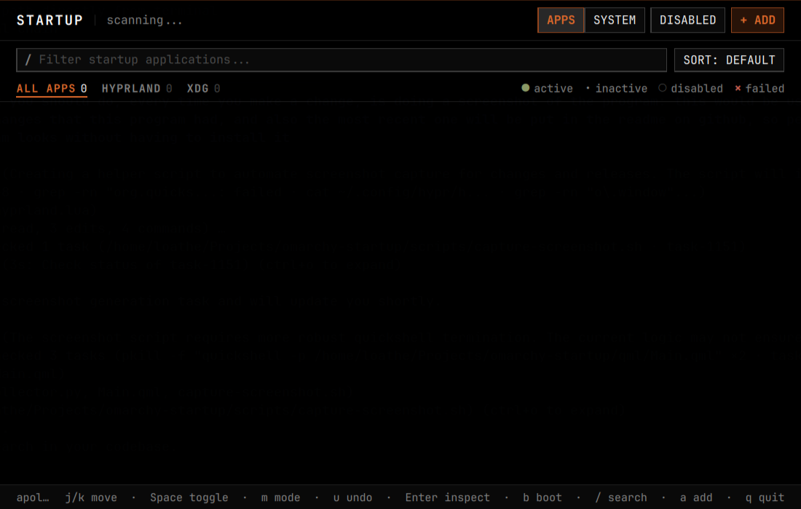

# omastart

Startup manager for Omarchy and Arch Linux (Hyprland).

Aggregates systemd units, Hyprland autostart commands, and Omarchy post-boot hooks into a single interface.



## Requirements

- Arch Linux or Omarchy
- Hyprland
- Dependencies: `python`, `quickshell`, `systemd`

## Install

### From Git

```bash
git clone https://github.com/vw5tywrl/omastart.git
cd omastart
./install.sh
```

Or build as a native package:
```bash
makepkg -si
```

To uninstall:
```bash
./uninstall.sh
```

## Usage

### GUI

Run `omastart` from terminal or your application launcher.

- `j` / `k` or `Up` / `Down`: navigate
- `Space`: toggle service
- `m`: toggle between Applications and System & Services views
- `u`: undo last toggle
- `Enter`: inspect service details and logs
- `e`: open config file in `$EDITOR` at exact line
- `r`: restart / rerun service
- `b`: view boot performance breakdown (critical path & slowest units)
- `!`: filter failed units
- `a`: add startup entry
- `Tab`: switch between Packages and Layers view (in System mode)
- `d`: show / hide disabled entries
- `s`: cycle sort (default, boot time, name)
- `/`: search filter
- `Esc` or `q`: quit / close modal

### CLI

```bash
# List active startup packages
omastart --list

# Include disabled units
omastart --list --all

# Output as JSON
omastart --json

# View systemd critical-chain dependency tree
omastart critical-chain

# Save or restore startup state snapshots
omastart snapshot save "my_preset"
omastart snapshot list
omastart snapshot restore "my_preset"
```

## License

[MIT](LICENSE)
