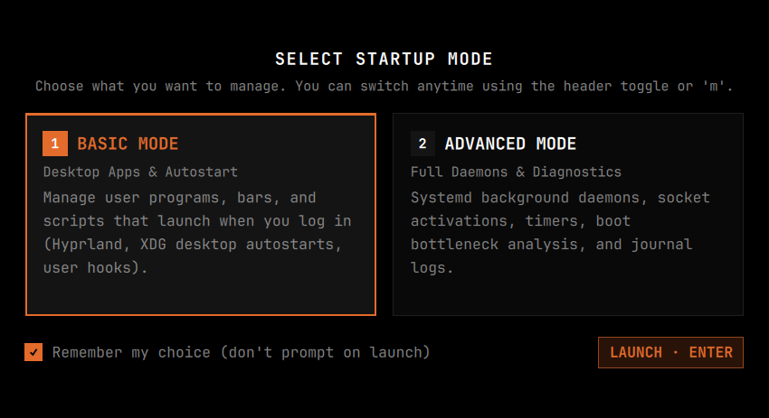
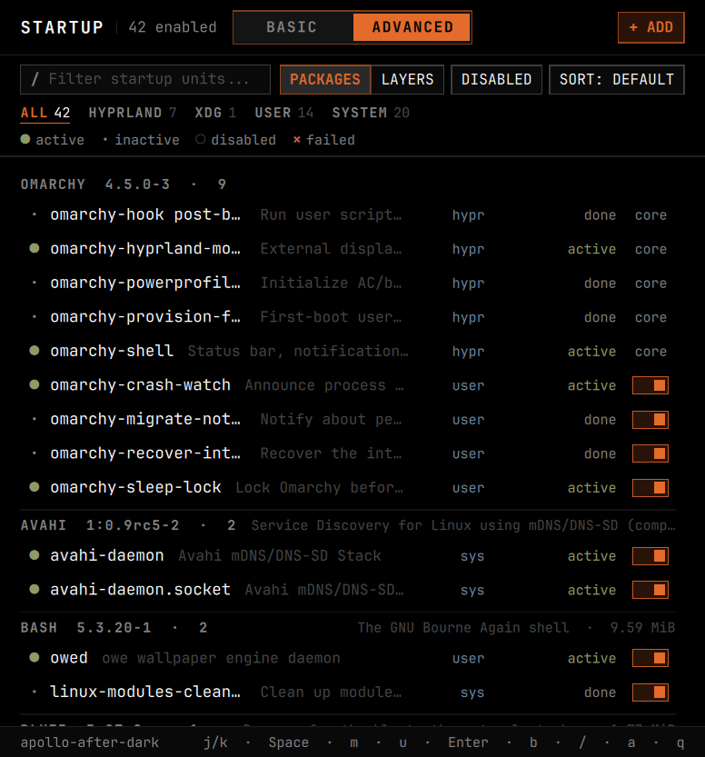

# omastart

Startup manager for [Omarchy](https://omarchy.org/) and Arch Linux (Hyprland).

Aggregates installed desktop applications, XDG autostart entries, `systemd` user & system units (services, sockets, timers), Hyprland autostart commands, and Omarchy post-boot hooks into a fast, native Qt6 Quick / Quickshell interface.



## Modes

Switch anytime using the centered `BASIC | ADVANCED` header toggle or by pressing `m`.

### Basic Mode

Clean, dead-simple login manager divided into **Enabled at Login** and **Available Applications**. Every installed desktop program (such as `Telegram`, `Firefox`, `Chromium`, `Obsidian`, etc.), user XDG autostart, Hyprland user autostart, and post-boot hook appears directly in the list — toggle any switch on to launch it automatically at next login, or toggle it off to remove it from startup without hunting through config files.


### Advanced Mode

Full system diagnostics and startup control across `systemd` system and user daemons, socket activations, timers, XDG autostarts, and Hyprland bootstrap entries. Supports **Packages** view (grouped by `pacman` package owner, version, description, and installed size) and **Layers** view, scope filtering (`All`, `Hyprland`, `XDG`, `User`, `System`), unit masking, essential-unit protection, boot bottleneck analysis, and live `journalctl` inspection.



## Features

### AI Error Inspection (`󰚩 ANALYZE`)

When one or more startup processes or `systemd` units fail, `omastart` surfaces a unified danger control in the top bar combining the failed counter (`× N FAILED`) with an inline **`󰚩 ANALYZE`** button inside the same control (as well as an **`󰚩 ANALYZE · I`** action inside the unit Inspector modal):

- **Left segment (`× N FAILED` / `!`)**: Filters the view to show only failed startup units.
- **Right segment (`󰚩 ANALYZE` / `i`)**: Automatically collects diagnostic context for the failed unit(s) — unit/config path, `pacman` package & version, launch command, `systemctl status`, and current-boot `journalctl` error logs — and hands it directly to your **default Omarchy AI agent** (`omarchy default agent` / `~/.config/omarchy/defaults/agent`) via `omarchy-agent --prompt`.
- Opens Omarchy's dedicated agent terminal (`org.omarchy.agent`) and immediately begins analyzing the root cause and proposing safe fixes. If no default agent has been selected in Omarchy yet, `omastart` copies the diagnostic prompt to your Wayland clipboard and opens Omarchy's agent selector (`omarchy-agent --pick`).

### Additional Highlights

- **Instant Toggles & Undo**: Optimistic UI switches (`Space` or click) flip immediately with zero UI lag, backed by non-blocking background updates and instant single-key undo (`u`).
- **Live Omarchy Theme Sync**: Automatically tracks your active Omarchy theme palette, monospace Nerd Font, font scale, and Hyprland window corner rounding live.
- **Add Custom Startup Entries (`+ ADD` / `a`)**: Add desktop applications, custom Hyprland `exec-once` / `autostart.lua` commands (with automatic `hyprctl configerrors` validation and rollback), or `~/.config/omarchy/hooks/post-boot.d/` scripts.
- **Boot Performance Breakdown (`b`)**: Inspect firmware, loader, kernel, initrd, and userspace timings alongside your slowest startup units and the `systemd-analyze critical-chain` dependency tree.
- **Startup State Snapshots**: Save and restore named presets of your enabled/disabled startup configuration from the CLI.

## Requirements

- Arch Linux or Omarchy
- Hyprland
- Dependencies: `python`, `quickshell`, `systemd`

## Install

### From Git

```bash
git clone https://github.com/vw5tywrl/omastart.git
cd omastart
./install.sh
```

Or build and install as a native Arch package:

```bash
makepkg -si
```

To uninstall:

```bash
./uninstall.sh
```

## Usage

### GUI

Run `omastart` from your terminal or application launcher.

| Key | Action |
|-----|--------|
| `j` / `k` or `Down` / `Up` | Navigate items (`PgUp` / `PgDn`, `g` / `G` for jump) |
| `Space` | Toggle selected startup item on / off |
| `u` | Undo last toggle |
| `m` | Switch between **Basic Mode** and **Advanced Mode** |
| `i` | Analyze failed startup process(es) with your default Omarchy AI agent |
| `!` | Toggle failed-units filter |
| `Enter` | Open unit Inspector (metadata, paths, and live `journalctl` logs) |
| `e` | Open unit / autostart configuration file in `$EDITOR` at exact line |
| `r` | Run / restart selected service (or reload scan in main list) |
| `b` | Open boot performance breakdown (slowest units & critical chain) |
| `a` or `Ctrl+N` | Add new startup application, Hyprland command, or post-boot hook |
| `Tab` | Toggle between **Packages** and **Layers** grouping (Advanced Mode) |
| `d` | Show / hide disabled units (Advanced Mode) |
| `s` | Cycle sort order (`Default`, `Boot Time`, `Name`) |
| `1` – `5` | Filter by scope (`All`, `Hyprland`, `XDG`, `User`, `System`) |
| `/` | Focus search / filter bar |
| `Esc` or `q` | Close modal / quit |

### CLI

```bash
# List active configured startup items
omastart --list

# Include disabled units
omastart --list --all

# Export startup state as JSON
omastart --json

# Print the systemd critical-chain dependency tree
omastart critical-chain

# Save, list, or restore startup state snapshots
omastart snapshot save "my_preset"
omastart snapshot list
omastart snapshot restore <snapshot_id>
```

## License

[MIT](LICENSE)
